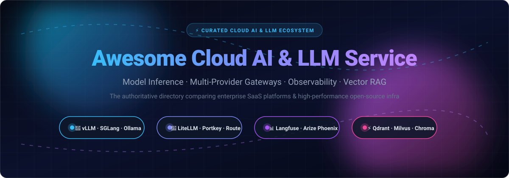

<div align="center">

<p align="center">
  
</p>

# 🚀 Awesome Cloud AI &amp; LLM Service

**The Definitive Curated Guide to Cloud AI Platforms, Enterprise LLM APIs, High-Throughput Inference Engines, Gateways, and AI Observability.**

[](https://github.com/ishandutta2007/Awesome-Awesome-Awesome)[](https://discord.gg/jc4xtF58Ve)
[](LICENSE)
[](CONTRIBUTING.md)
[](https://github.com/ishandutta2007/Awesome-Cloud-AI-LLM-Service)
[](https://github.com/ishandutta2007/Awesome-Cloud-AI-LLM-Service/stargazers)
[](https://github.com/ishandutta2007/Awesome-Cloud-AI-LLM-Service/network)
<a href="https://github.com/ishandutta2007"></a>

**🌟 Star this repository if you find it helpful for your AI stack! 🌟**

</div>

---

## 📌 Executive Summary &amp; Overview

Welcome to **Awesome-Cloud-AI-LLM-Service** — an authoritative, SEO-optimized, industry-standard landscape directory tracking **enterprise Cloud AI SaaS platforms**, **LLM API providers**, and **high-performance open-source AI infrastructure**.

Whether you are architecting a multi-tenant LLM application, selecting an enterprise frontier model vendor, deploying local self-hosted inference clusters, or integrating unified gateways with intelligent fallback and semantic caching, this catalog provides transparent metrics across:
* **Model Inference &amp; Serving Engines** (vLLM, SGLang, Ollama, llama.cpp, TensorRT-LLM)
* **Cloud AI Platforms &amp; Frontier Model APIs** (OpenAI API, Anthropic Claude, Google Cloud Vertex AI, AWS Bedrock, Azure OpenAI)
* **LLM Proxies &amp; Multi-Provider Gateways** (LiteLLM, Portkey Gateway, RouteLLM)
* **AI Observability, Tracing, &amp; LLMOps** (Langfuse, Arize Phoenix, OpenLIT)
* **Vector Databases for Enterprise RAG** (Qdrant, Milvus, Chroma, Weaviate)

---

## 📑 Table of Contents

- [📈 Sector Overview &amp; Market Dynamics](#-sector-overview--market-dynamics)
- [☁️ SaaS / Hosted Cloud AI Platforms](#️-saas--hosted-cloud-ai-platforms)
- [💻 Open-Source GitHub Projects](#-open-source-github-projects)
- [🛠️ Architectural Blueprints &amp; Stacks](#️-architectural-blueprints--stacks)
- [🤝 How to Contribute](#-how-to-contribute)
- [💖 Support &amp; Sponsorship](#-support--sponsorship)
- [📊 Star History](#-star-history)
- [⚖️ Disclaimer](#️-disclaimer)

---

## 📈 Sector Overview &amp; Market Dynamics

The global **Cloud AI &amp; Enterprise LLM Services** sector is valued between **$88B and $116B in 2025** and is projected to expand beyond **$114B to $230B+ in 2026**, sustaining a compound annual growth rate (CAGR) exceeding 25–35%.

The competitive landscape demonstrates a distinctive **dual-tier market concentration**:
1. **Upstream Foundation Models &amp; Compute Infrastructure (Highly Concentrated / Oligopolistic):** The foundational model tier and hyperscale compute cluster layer are heavily dominated by hyperscale cloud titans (**Microsoft Azure, Alphabet Google Cloud, Amazon Web Services**) alongside elite frontier research laboratories (**OpenAI, Anthropic**). Training and maintaining frontier model parameters requires billions of dollars in specialized GPU clusters, custom accelerators (TPUs/Trainium), and proprietary data pipelines, creating high barriers to entry.
2. **Downstream AI Engineering, Gateway, &amp; Tooling Layer (Moderately Fragmented):** Conversely, the downstream ecosystem—including LLM routing gateways, AI observability suites, agent orchestration frameworks, and vector search—is moderately fragmented. High-velocity open-source tools compete head-to-head with specialized SaaS startups, empowering developers to avoid cloud vendor lock-in through standardized OpenAI-compatible APIs and modular self-hosted stacks.

---

## ☁️ SaaS / Hosted Cloud AI Platforms

The following table provides verified, transparent pricing benchmarks, free tier entitlements, and valuation metrics for commercial Cloud AI providers, sorted in descending order by company valuation/market capitalization.

| 🏢 Platform | 💰 Valuation / Company Size | 🏷️ Verified Pricing | 🎁 Free Tier / Trial Limits | 🔍 Description &amp; Best For |
| :--- | :--- | :--- | :--- | :--- |
| **[Azure OpenAI Service](https://azure.microsoft.com/en-us/products/ai-services/openai-service)** | **$3.88T Market Cap** *(Microsoft)* | Starts at **$0.15 / 1M input tokens** &amp; **$0.60 / 1M output tokens** (GPT-4o-mini); provisioned throughput units (PTU) available | **$200 free trial credits valid for 30 days** across all Azure cloud services upon account registration | Azure-managed OpenAI models with SOC2/HIPAA compliance, private VNet endpoints, and native content filtering. *Best for Microsoft-centric enterprise ecosystems.* |
| **[Google Cloud Vertex AI](https://cloud.google.com/vertex-ai)** | **$3.46T Market Cap** *(Alphabet)* | Starts at **$0.10 / 1M input tokens** &amp; **$0.40 / 1M output tokens** (Gemini Flash); Gemini Pro starts at $2.00 / 1M input tokens | **$300 free trial credits valid for 90 days** for new Google Cloud accounts | Unified enterprise AI studio with Gemini family models, Model Garden (150+ third-party models), and end-to-end MLOps. *Best for teams invested in Google Cloud data pipelines.* |
| **[AWS Bedrock](https://aws.amazon.com/bedrock/)** | **$2.60T Market Cap** *(Amazon)* | Starts at **$0.06 / 1M input tokens** &amp; **$0.24 / 1M output tokens** (Amazon Nova Micro); Claude 3.5 Sonnet at $3.00/$15.00 per 1M tokens | **Up to $200 in AWS promotional credits** for new accounts (no standalone permanent free tier; billed on consumption) | Serverless managed foundation model platform offering Anthropic Claude, Meta Llama, Mistral, and Amazon Nova via a unified SDK. *Best for AWS-native applications.* |
| **[OpenAI API](https://openai.com/)** | **$852B Valuation** *(OpenAI)* | Starts at **$0.15 / 1M input tokens** &amp; **$0.60 / 1M output tokens** (GPT-4o-mini); o1/o3 reasoning models billed on input/output/reasoning tokens | **$100/mo spend ceiling on Free Usage Tier** (calls require paid prepay credits from $5 or bundled ChatGPT Pro/Business $100–$500/mo API credit grants) | Industry-defining frontier model API featuring GPT-4o, o-series reasoning models, Whisper audio, and Vision. *Best for developers prioritizing state-of-the-art capability and broad ecosystem support.* |
| **[Anthropic API](https://www.anthropic.com/)** | **$965B Valuation / Pre-IPO** *(Anthropic)* | Starts at **$0.25 / 1M input tokens** &amp; **$1.25 / 1M output tokens** (Claude 3.5 Haiku); prompt caching discounts up to 90% | **$5 one-time initial credit trial** upon phone verification (or $100–$200/mo recurring credit for Claude Max/Ultra subscribers) | Frontier Claude 3.5 / 3.7 model family with 200K+ token context windows, computer use, and Constitutional AI safety alignment. *Best for complex coding, synthesis, and deep reasoning.* |
| **[Databricks Mosaic AI](https://www.databricks.com/)** | **$190B Valuation** *(Databricks)* | Starts at **$0.07 per DBU** for serverless model serving; pay-per-token foundation model endpoints available | **14-day full platform free trial** (Community Edition available with limited compute; underlying cloud VMs billed to customer) | Integrated AI platform for building, evaluating, and deploying production models directly over enterprise Lakehouse data. *Best for Databricks Lakehouse customers.* |
| **[Snowflake Cortex AI](https://www.snowflake.com/)** | **$115B Market Cap** *(Snowflake)* | Starts at **$2.00 per AI Credit** for cross-cloud global routing, in addition to standard virtual warehouse compute credits | **$400 in free trial credits valid for 30 days** on new Snowflake enterprise trials | In-warehouse LLM functions (`COMPLETE`, `SEARCH`, `SUMMARIZE`) running without moving data beyond the compliance boundary. *Best for data warehousing and SQL-native analytics.* |
| **[Mistral AI](https://mistral.ai/)** | **$24B Valuation** *(Mistral AI)* | Starts at **$0.15 / 1M input tokens** &amp; **$0.60 / 1M output tokens** (Ministral 3B); Mistral Large at $0.50 / 1M input tokens | **Free Tier forever mode on La Plateforme**: rate-limited to ~1 request/sec (30 RPM) for prototyping and evaluation | European frontier and open-weight model powerhouse (Mistral Large, Codestral, Pixtral) with European hosting options. *Best for data sovereignty and high efficiency.* |
| **[Cohere](https://cohere.com/)** | **$20B Valuation** *(Cohere)* | Starts at **$0.15 / 1M input tokens** &amp; **$0.60 / 1M output tokens** (Command R); Embed at $0.10 / 1M tokens, Rerank at $2.00 / 1K searches | **Free Trial Key**: 1,000 API calls per month forever (strictly evaluation use; throttled to 20 RPM chat / 10 RPM rerank) | Enterprise-focused models engineered specifically for retrieval-augmented generation (RAG), embedding generation, and semantic reranking. *Best for enterprise knowledge discovery.* |
| **[Groq Cloud](https://groq.com/)** | **$3.5B Valuation** *(Groq)* | Starts at **$0.05 / 1M input tokens** &amp; **$0.08 / 1M output tokens** (Llama 3.1 8B on custom LPUs); on-demand pay-per-token billing | **Free Tier forever**: 30 requests per minute (RPM) and 6,000 to 30,000 tokens per minute (TPM) limit across accounts | Custom Language Processing Unit (LPU) silicon delivering hundreds of tokens per second with near-instant time-to-first-token. *Best for voice AI agents and latency-sensitive real-time apps.* |

---

## 💻 Open-Source GitHub Projects

Explore the open-source AI ecosystem, sorted in descending order by GitHub Stargazers ⭐.

- **[Ollama](https://github.com/ollama/ollama)** [](https://github.com/ollama/ollama/stargazers)  
  🦙 **Local LLM runtime with one-command model management** `[License: MIT]`  
  *Overview*: The most popular tool for running open-weight LLMs locally across macOS, Linux, and Windows.  
  *Key Features*: One-command model management (`ollama run llama3`), OpenAI-compatible HTTP REST endpoint, integrated Modelfile customizations, and out-of-the-box GPU acceleration for Apple Silicon and NVIDIA.  
  *Trade-off*: Designed for developer local execution and single-user workflows; not optimized for multi-tenant concurrent production serving.  
  *Best for*: Prototyping, desktop applications, edge computing, and offline development.

- **[Dify](https://github.com/langgenius/dify)** [](https://github.com/langgenius/dify/stargazers)  
  ⚡ **Production-ready LLM application development &amp; LLMOps platform** `[License: Apache 2.0]`  
  *Overview*: An end-to-end open-source visual workflow engine and LLMOps suite for building AI agents and enterprise RAG.  
  *Key Features*: Visual orchestration canvas, prompt engineering IDE, multi-agent collaboration, model management for 50+ providers, and integrated log analytics.  
  *Trade-off*: Requires coordinating multiple supporting microservices (PostgreSQL, Redis, Celery workers, Vector DB).  
  *Best for*: Enterprises seeking a turnkey AI application platform without coding low-level plumbing from scratch.

- **[Open WebUI](https://github.com/open-webui/open-webui)** [](https://github.com/open-webui/open-webui/stargazers)  
  🖥️ **Feature-rich self-hosted UI for Ollama, vLLM, and OpenAI-compatible APIs** `[License: MIT]`  
  *Overview*: The premier self-hosted, user-friendly ChatGPT clone interface for internal organizational deployment.  
  *Key Features*: Granular role-based access control (RBAC), native document RAG, web search integration, voice/audio interactions, and multi-model comparison chats.  
  *Trade-off*: Pure frontend and proxy layer; requires separate backing inference engines to serve model tokens.  
  *Best for*: Delivering a privacy-preserving, enterprise-grade AI chat assistant to employees.

- **[llama.cpp](https://github.com/ggerganov/llama.cpp)** [](https://github.com/ggerganov/llama.cpp/stargazers)  
  ⚙️ **Ultra-portable LLM inference in pure C/C++** `[License: MIT]`  
  *Overview*: The foundational library powering local LLM inference across diverse consumer and server hardware.  
  *Key Features*: Originator of the GGUF model format, support for aggressive 1.5-bit to 8-bit integer quantization, Metal/CUDA/Vulkan/ROCm support, and zero-dependency CPU-only execution.  
  *Trade-off*: Lower batch-throughput and concurrency than dedicated multi-GPU serving engines like vLLM.  
  *Best for*: Edge devices, laptops, embedded hardware, and CPU-only environments.

- **[vLLM](https://github.com/vllm-project/vllm)** [](https://github.com/vllm-project/vllm/stargazers)  
  🚀 **High-throughput and memory-efficient LLM inference and serving engine** `[License: Apache 2.0]`  
  *Overview*: The de facto industry standard engine for self-hosted, high-concurrency model serving.  
  *Key Features*: **PagedAttention** algorithm eliminating KV cache memory fragmentation, continuous batching, chunked prefill, tensor parallelism across NVIDIA/AMD/Intel GPUs and TPUs, and full OpenAI API compatibility.  
  *Trade-off*: Requires dedicated server GPU hardware and operational expertise for multi-node cluster management.  
  *Best for*: Production cloud infrastructure, multi-tenant SaaS backends, and high-volume inference clusters.

- **[LiteLLM](https://github.com/BerriAI/litellm)** [](https://github.com/BerriAI/litellm/stargazers)  
  🔀 **Universal LLM gateway, proxy, and spend management system** `[License: MIT]`  
  *Overview*: The most widely adopted proxy for routing, rate-limiting, and standardizing calls across 100+ AI providers.  
  *Key Features*: 100% OpenAI-compatible API proxy, virtual team keys with budget caps and rate limits, spend analytics, automated failover load balancing, and guardrail middleware.  
  *Trade-off*: The open-source version lacks advanced semantic caching; enterprise governance requires a commercial tier.  
  *Best for*: Engineering teams needing unified model access with centralized billing controls and automated fallbacks.

- **[Milvus](https://github.com/milvus-io/milvus)** [](https://github.com/milvus-io/milvus/stargazers)  
  🗄️ **Cloud-native distributed vector database for billion-scale similarity search** `[License: Apache 2.0]`  
  *Overview*: Built from the ground up for massive-scale similarity search and AI vector storage.  
  *Key Features*: Cloud-native decoupled architecture, billion-scale indexing, GPU-accelerated search, hybrid vector/scalar queries, and complete multi-tenancy.  
  *Trade-off*: Significant operational footprint; less ideal for small standalone microservices.  
  *Best for*: Large-scale enterprise RAG search systems managing hundreds of millions of document embeddings.

- **[SGLang](https://github.com/sgl-project/sglang)** [](https://github.com/sgl-project/sglang/stargazers)  
  ⚡ **High-performance serving framework with RadixAttention for reasoning and RAG** `[License: Apache 2.0]`  
  *Overview*: An inference engine engineered for extreme speed in multi-turn dialogues, agentic pipelines, and RAG.  
  *Key Features*: **RadixAttention** enabling automatic KV cache reuse across shared prefixes, up to 29%+ throughput boost on RAG workflows, fast structured JSON decoding, and multi-GPU tensor parallelism.  
  *Trade-off*: Hardware compatibility list is narrower than vLLM.  
  *Best for*: RAG applications, multi-agent frameworks, and structured output generation where prefix caching shines.

- **[Langfuse](https://github.com/langfuse/langfuse)** [](https://github.com/langfuse/langfuse/stargazers)  
  📊 **Open-source LLM engineering platform for observability, tracing, and evaluations** `[License: MIT]`  
  *Overview*: The premier open-source observability suite for debugging, analyzing, and improving LLM applications.  
  *Key Features*: Granular nested execution tracing, prompt management with versioning, LLM-as-a-judge automated evals, dataset curation, and real-time cost/token tracking.  
  *Trade-off*: Observability and telemetry only; does not serve models or proxy requests.  
  *Best for*: Production LLM applications requiring deep visibility into latency, cost, and output quality.

- **[Qdrant](https://github.com/qdrant/qdrant)** [](https://github.com/qdrant/qdrant/stargazers)  
  🦀 **Rust-based vector search engine and database with payload filtering** `[License: Apache 2.0]`  
  *Overview*: The pragmatic, high-performance vector database of choice for production RAG systems.  
  *Key Features*: Implemented in Rust for high throughput and predictable memory usage, filterable HNSW indexing, scalar/product quantization, payload filtering, and tenant isolation.  
  *Trade-off*: Requires infrastructure-level disk encryption management.  
  *Best for*: Production RAG applications requiring fast search coupled with complex business metadata filters.

- **[Chroma](https://github.com/chroma-core/chroma)** [](https://github.com/chroma-core/chroma/stargazers)  
  🎨 **AI-native open-source embedding database for rapid prototyping** `[License: Apache 2.0]`  
  *Overview*: The simplest and most approachable vector database for developers starting with RAG.  
  *Key Features*: Minimal setup with Python/TypeScript bindings, in-memory or client-server modes, built-in vectorization, and lightweight footprint.  
  *Trade-off*: Scalability boundaries on multi-million vector datasets compared to distributed solutions.  
  *Best for*: Prototyping, hackathons, desktop apps, and small-to-medium scale document stores.

- **[Weaviate](https://github.com/weaviate/weaviate)** [](https://github.com/weaviate/weaviate/stargazers)  
  🔍 **Cloud-native vector database with integrated hybrid search and modules** `[License: BSD-3-Clause]`  
  *Overview*: An extensible vector search engine combining semantic search with keyword BM25 retrieval.  
  *Key Features*: Native hybrid search (BM25 + vector cosine), plug-and-play vectorization modules, multi-modal search, and GraphQL/REST APIs.  
  *Trade-off*: Memory consumption can be intensive when managing large unquantized indexes.  
  *Best for*: Complex semantic search pipelines combining keyword matching, vector similarity, and multimodal content.

- **[TensorRT-LLM](https://github.com/NVIDIA/TensorRT-LLM)** [](https://github.com/NVIDIA/TensorRT-LLM/stargazers)  
  🏎️ **NVIDIA-optimized inference library for extreme GPU performance** `[License: Apache 2.0]`  
  *Overview*: NVIDIA's official high-throughput acceleration library for Hopper and Blackwell architectures.  
  *Key Features*: Deep TensorRT compilation, custom FP8/FP4 kernels, in-flight batching, and maximum hardware FLOPs utilization delivering 30–60% speedups over generic runtimes.  
  *Trade-off*: Hardware lock-in to NVIDIA GPUs; closed-source driver dependencies and complex installation.  
  *Best for*: High-volume inference clusters on NVIDIA H100/H200/B200 hardware prioritizing minimal per-token serving cost.

- **[Portkey Gateway](https://github.com/portkey-ai/gateway)** [](https://github.com/portkey-ai/gateway/stargazers)  
  🛡️ **Ultra-fast, production-ready AI gateway connecting 250+ LLMs** `[License: Apache 2.0]`  
  *Overview*: A lightweight, sub-millisecond AI gateway engine built for high-throughput enterprise routing.  
  *Key Features*: Sub-10MB binary footprint, multi-provider fallbacks, automatic retries, load balancing, and support for over 250 LLM APIs.  
  *Trade-off*: Guardrail configurations and semantic caching are tightly linked with their commercial cloud tier.  
  *Best for*: Production applications requiring an ultra-low-latency proxy with built-in resilience.

- **[OpenLLM](https://github.com/bentoml/OpenLLM)** [](https://github.com/bentoml/OpenLLM/stargazers)  
  📦 **Packaging and serving open-source LLMs into production microservices** `[License: Apache 2.0]`  
  *Overview*: Part of the BentoML ecosystem, streamlining the operational deployment of fine-tuned and open-source models.  
  *Key Features*: Built on top of vLLM, one-command model spin-up, Docker/OCI containerization automation, and Kubernetes orchestration support.  
  *Trade-off*: An additional abstraction layer over direct vLLM deployment.  
  *Best for*: Engineering teams standardizing model releases inside Kubernetes-centric CI/CD pipelines.

- **[Arize Phoenix](https://github.com/Arize-ai/phoenix)** [](https://github.com/Arize-ai/phoenix/stargazers)  
  🔭 **OpenTelemetry-native AI observability, evaluation, and tracing** `[License: Apache 2.0]`  
  *Overview*: An AI evaluation and observability platform built strictly around OpenTelemetry standards.  
  *Key Features*: Native OpenTelemetry tracing, automated RAG evaluation, LLM-as-a-judge scoring, and seamless Jupyter notebook integration.  
  *Trade-off*: Smaller prompt-versioning ecosystem compared to Langfuse.  
  *Best for*: Teams running OpenTelemetry observability backends who need specialized AI trace visualizations.

- **[Triton Inference Server](https://github.com/triton-inference-server/server)** [](https://github.com/triton-inference-server/server/stargazers)  
  🏭 **Enterprise multi-framework inference serving platform by NVIDIA** `[License: BSD-3-Clause]`  
  *Overview*: NVIDIA's battle-tested inference serving platform supporting heterogeneous model types concurrently.  
  *Key Features*: Multi-framework support (PyTorch, TensorRT-LLM, ONNX, TensorFlow), concurrent model execution on shared GPUs, dynamic batching, and production gRPC/HTTP interfaces.  
  *Trade-off*: Steep learning curve and complex configuration management compared to dedicated LLM runners.  
  *Best for*: Large enterprise platforms concurrently serving computer vision, tabular ML, and LLMs on shared GPU fleets.

- **[Text Generation Inference (TGI)](https://github.com/huggingface/text-generation-inference)** [](https://github.com/huggingface/text-generation-inference/stargazers)  
  🤗 **Hugging Face's purpose-built LLM deployment and serving toolkit** `[License: OpenRAIL/Custom]`  
  *Overview*: The serving runtime powering Hugging Face Inference Endpoints.  
  *Key Features*: Tensor parallelism, continuous batching, token streaming, FlashAttention, and direct plug-and-play integration with the Hugging Face Hub.  
  *Trade-off*: Transitioned some components to non-permissive open-core licensing; hardware support is primarily NVIDIA-centric.  
  *Best for*: Organizations with workloads closely bound to the Hugging Face Hub and Hugging Face Enterprise.

- **[Xinference](https://github.com/xorbitsai/inference)** [](https://github.com/xorbitsai/inference/stargazers)  
  🌐 **Distributed inference system for language, speech, and multimodal models** `[License: Apache 2.0]`  
  *Overview*: A distributed inference cluster manager capable of serving text, embedding, speech, and image models together.  
  *Key Features*: Unified cluster orchestration, automated model downloading, multi-node scaling, and OpenAI-compatible endpoints across modalities.  
  *Trade-off*: Newer project with a smaller enterprise community.  
  *Best for*: Teams operating a unified compute cluster running multimodal models alongside LLMs.

- **[BentoML](https://github.com/bentoml/BentoML)** [](https://github.com/bentoml/BentoML/stargazers)  
  🍱 **Unified model serving framework for production AI applications** `[License: Apache 2.0]`  
  *Overview*: A flexible Python-first framework for building, testing, and shipping production ML and AI services.  
  *Key Features*: Adaptive batching, multi-model execution pipelines, automated containerization, and seamless integration with cloud infrastructure.  
  *Trade-off*: Requires pairing with specialized engines (like vLLM) for high-performance generative LLM serving.  
  *Best for*: Composite AI microservices combining classical machine learning models with generative AI components.

- **[RouteLLM](https://github.com/lm-sys/RouteLLM)** [](https://github.com/lm-sys/RouteLLM/stargazers)  
  🧠 **Cost-optimizing intelligent query router from LMSYS** `[License: Apache 2.0]`  
  *Overview*: An algorithmic router that directs easy queries to cheap models and complex queries to frontier models.  
  *Key Features*: Trained on LMSYS Chatbot Arena human preference data; preserves ~95% of GPT-4 quality while drastically slashing token costs by ~85%.  
  *Trade-off*: Algorithmic router only; requires pairing with an underlying gateway (such as LiteLLM) to perform actual dispatch.  
  *Best for*: High-volume production deployments looking to reduce API spend without degrading user experience.

- **[OpenLIT](https://github.com/openlit/openlit)** [](https://github.com/openlit/openlit/stargazers)  
  🔥 **OpenTelemetry-native AI and GPU observability and tracing** `[License: Apache 2.0]`  
  *Overview*: Auto-instrumentation platform tracking both software application traces and physical GPU telemetry.  
  *Key Features*: One-line auto-instrumentation for 30+ LLM frameworks and vector stores, GPU hardware metrics (VRAM, temperature, power), and export to Prometheus/Grafana.  
  *Trade-off*: Younger project in active development.  
  *Best for*: Infrastructure engineers and DevOps teams desiring correlated software and hardware observability.

---

## 🛠️ Architectural Blueprints &amp; Stacks

Depending on your compliance requirements, latency budgets, and engineering capabilities, consider these three industry-standard patterns:

```
[Pattern 1: Self-Hosted Sovereign Stack]
User Request ──► LiteLLM / Portkey (Gateway) ──► vLLM / SGLang (Inference) ──► Qdrant / Milvus (RAG)
                                       │
                                       └──► Langfuse (Observability & Tracing)

[Pattern 2: Hybrid Enterprise Multi-Cloud Stack]
User Request ──► RouteLLM / LiteLLM ──┬─► AWS Bedrock / Azure OpenAI (Frontier Models)
                                       └─► Self-Hosted vLLM (Internal Fine-Tuned Models)

[Pattern 3: Local Prototyping & Edge AI]
Developer ──► Open WebUI ──► Ollama / llama.cpp (GGUF Quantized Models) ──► Chroma (Vector Store)
```

---

## 🤝 How to Contribute

We welcome contributions from the community! To propose additions or updates:

1. 🍴 **Fork** this repository.
2. 📝 **Add/Edit** entries in [README.md](README.md) following our standardized tabular or listed schema.
3. 🔍 **Verify Data**: Ensure pricing details, free tier limits, Stars_Counts, and licensing information are accurate and verifiable.
4. 🚀 **Submit a Pull Request** with a concise description of your additions.

---

## 💖 Support &amp; Sponsorship

If this curated repository saved you engineering hours, helped optimize your cloud AI infrastructure costs, or guided your architecture decisions, please consider supporting the project:

- ⭐ **Star this repository** on GitHub to increase its visibility.
- 🍴 **Fork and share** it with your engineering colleagues and AI community.
- ☕ **Sponsor the Maintainer**: Buy us a coffee and support continued maintenance on the [GitHub Sponsors Dashboard](https://github.com/sponsors/ishandutta2007).

Thank you for being part of the open AI engineering community! ❤️

---

## 📊 Star History

[](https://star-history.dera.page/#ishandutta2007/Awesome-Cloud-AI-LLM-Service&type=date&legend=top-left)

---

## ⚖️ Disclaimer

- This catalog is **community-curated** for educational, architectural, and informational purposes. Mention does not constitute an endorsement.
- Generative AI platforms handling sensitive data must comply with jurisdictional privacy mandates (GDPR, CCPA, HIPAA, SOC 2). Always configure appropriate data processing agreements, zero-data-retention options, and network perimeter controls.
- **Architectural Separation**:
  - **Frontier Model APIs** (OpenAI, Anthropic, Mistral, Cohere, Groq) sell access to proprietary weights and managed endpoints.
  - **Managed Enterprise Clouds** (AWS Bedrock, Vertex AI, Azure OpenAI, Snowflake Cortex, Databricks Mosaic) bundle models within enterprise security perimeters.
  - **Inference Engines** (vLLM, SGLang, Ollama, llama.cpp, TensorRT-LLM, TGI) serve open-weight models on hardware you control.
  - **AI Gateways &amp; Routers** (LiteLLM, Portkey Gateway, RouteLLM) unify APIs, enforce rate limits, and optimize cost.
  - **Observability Platforms** (Langfuse, Arize Phoenix, OpenLIT) monitor traces, latency, and model outputs.
  - **Vector Databases** (Milvus, Qdrant, Chroma, Weaviate) index and retrieve document embeddings for RAG.

---

<div align="center">

**Made with ❤️ for AI engineers, MLOps practitioners, and organizations building transparent cloud AI infrastructure.**

</div>
